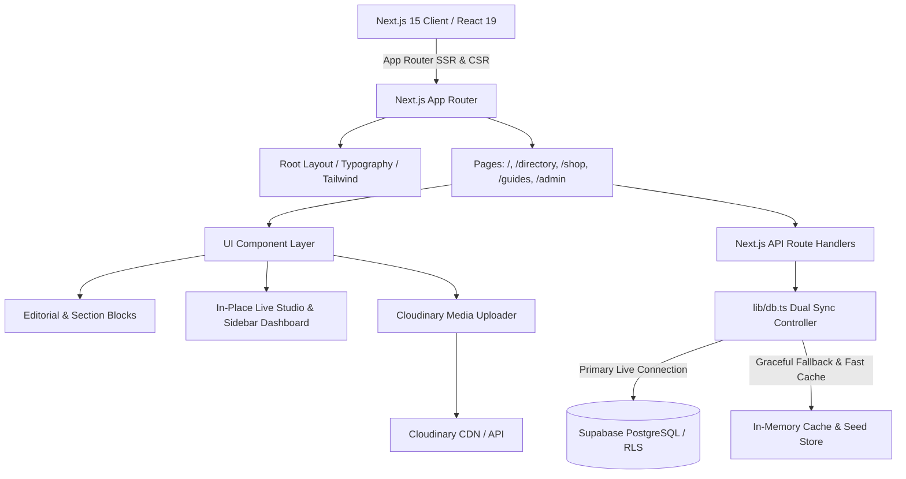

# 01 — ARCHITECTURE AUDIT: DESIGNERSALE (DS/) & WEBLOOM APPLICATION CORE

## 1. Executive Architecture Summary
**DESIGNERSALE (DS/)** is an editorial visual discovery directory and digital publishing studio tailored for Australian independent fashion flagships, rare archive boutiques, artisan ceramicists, and design bookstores. The application is built upon Next.js 15 (App Router) with React 19, Tailwind CSS, Cloudinary asset orchestration, and a dual-mode persistence architecture combining an active in-memory / local state synchronization layer with Supabase PostgreSQL and Row-Level Security.

---

## 2. Technology Stack & Dependency Hierarchy

### Detailed Dependencies:
- **Core Framework:** Next.js `15.1.0` (React `19.0.0`, React-DOM `19.0.0`)
- **Styling & Typography:** Tailwind CSS `3.4.16`, PostCSS, custom serif (`font-editorial-serif` - Cormorant Garamond / Canela serif stack) and technical sans (`font-editorial-sans` - Neue Montreal / Haas Grotesk stack).
- **Icons:** `lucide-react` `1.16.0`
- **Database & Backend:** `@supabase/supabase-js` `2.119.0`
- **Media Asset Pipeline:** `cloudinary` `2.11.0`
- **Testing & Browser Automation:** `@playwright/test` `1.49.1`

---

## 3. Directory & Structural Architecture

| Directory | Purpose & Contents | Architectural Notes |
|---|---|---|
| `app/` | App Router route segments, layouts, and API route handlers | Standardized server/client component boundaries |
| `app/api/` | REST endpoint handlers (`boutiques`, `guides`, `journal`, `products`, `upload`, `seed`) | Fully JSON-compliant CRUD endpoints |
| `components/admin/` | Admin consoles: `LiveInPlaceStudio`, `NormalAdminPanel`, `AdminDashboardClient`, modals | Two synchronized modes: in-place visual canvas + classic sidebar |
| `components/directory/`| Directory Index client: filtering, search, responsive 4-column boutique grid | Dual city & category facet filters |
| `components/guides/` | Editorial city guides: `MelbourneGuideClient` (photo essays, precinct breakdowns) | Deep reading layout |
| `components/shop/` | Shop profile engine, `EditorialFeed`, dynamic block renderers, sticky sidebar, map | Modular block CMS architecture |
| `components/shop/blocks/` | Block CMS components (`TextWithImage`, `PullQuote`, `ImageDuo`, `FullBleed`, `DesignerRoster`) | Pure in-place WYSIWYG without clunky form boxes |
| `components/modals/` | Modal dialogs (`SubmitShopModal`, `ImageSwapModal`, `SimilarShopsModal`) | Accessible overlay dialogs |
| `lib/` | Infrastructure clients (`db.ts`, `supabaseClient.ts`, `cloudinary.ts`, `operatingHours.ts`) | Unified database abstraction layer |
| `data/` | Seed data (`boutiques.ts`, `products.ts`, `journal.ts`, `seedShop.ts`) | Rich editorial baseline dataset |
| `tests/` | Playwright test suites (`landing-page`, `shop-profile`, `listing-and-guide`, `admin-and-products`) | Verified 28/28 passing tests |

---

## 4. Key Architectural Strengths
1. **Resilient Dual-Mode Persistence:** `lib/db.ts` automatically probes Supabase; if reachable, queries execute against remote PostgreSQL. If offline or in isolated local development, it falls back seamlessly to an in-memory cache seeded with comprehensive Australian boutique data, guaranteeing zero crashes or blank screens.
2. **Kaftan-Style In-Place Studio:** Live on-page editorial editing operates directly over the actual typography, styles, and photo frames without disruptive form containers.
3. **Robust Test Infrastructure:** Headless browser automation via Playwright tests responsive layouts, block movements, boundary conditions, and media fallbacks.

---

## 5. Architectural Deficiencies & Incomplete Implementations Identified
1. **Header Search Disconnect:** The global `MainHeader` search drawer did not forward search queries to `/directory?q=...`.
2. **"Submit a Shop" Orphan:** The `SubmitShopModal` existed in `components/modals/` but was not wired into `MainHeader` or landing page actions.
3. **Static Routing to Default Shop:** Cards in `DirectoryListingClient` and `DirectorySection` linked to `/shop` rather than passing the selected boutique ID (`/shop?id=...`).
4. **Shop Profile Query Hydration:** `ShopProfileClient` relied solely on `SEED_SHOP_PROFILE` or a single `localStorage` key rather than dynamically loading the specific boutique requested via URL parameters.

