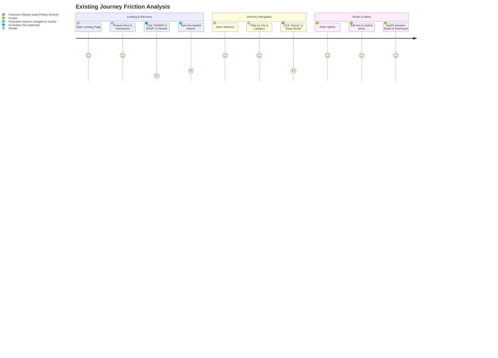

# 04 — USER JOURNEY AUDIT & FRICTION ANALYSIS

## 1. User Types & Personas
Through architectural and interaction review, four primary user classes interact with DESIGNERSALE:

1. **The Casual Design Enthusiast (Reader / Explorer):**
   - Goal: Discover curated independent stores, craftspeople, and architectural spaces in their city.
   - Entry Point: Search engine, social link, or home page (`/`).
   - Friction Points:
     - When clicking "SUBMIT A SHOP" in the top bar, nothing opened.
     - When searching in the header, pressing enter or typing did not lead to search results.
     - When browsing the directory and clicking a boutique card, every card opened the same default shop (`parlour-archive-fitzroy`) instead of the clicked boutique.

2. **The City Traveler / Itinerary Planner:**
   - Goal: Find boutiques grouped by precinct (Fitzroy, Armadale, Paddington, Surry Hills).
   - Entry Point: `/guides/melbourne-edit` or precinct filters.
   - Friction Points:
     - In the Melbourne Guide, clicking on recommended boutiques in the itinerary did not open their dedicated editorial profiles with maps.

3. **The Boutique Proprietor / Submitter:**
   - Goal: Submit their boutique, studio, or concept store for inclusion in the directory.
   - Entry Point: "SUBMIT A SHOP" button in the navigation header.
   - Friction Points:
     - Modal was not connected; even when opened, form submission didn't persist to the database.

4. **The Editorial Curator & Administrator:**
   - Goal: Update boutique metadata, edit editorial essays live on-page, reorder layout blocks, upload photos via Cloudinary, and manage database records.
   - Entry Point: `/admin` or `/admin/dashboard`.
   - Friction Points:
     - Previously had clunky form input boxes obscuring the live visual layout (now resolved).
     - Need a frictionless way to jump between any boutique, city guide, and article directly inside both the Live Studio and the Sidebar Admin.

---

## 2. Friction Points & Abandonment Traps

---

## 3. High-Priority Journey Fixes Required
1. **Connect Header Search:** When a user types a query in the `MainHeader` search bar and submits, navigate them to `/directory?q={query}`.
2. **Wire "SUBMIT A SHOP":** Make the header button open `SubmitShopModal` everywhere, and ensure form submission calls `POST /api/boutiques` to persist the new submission.
3. **Dynamic Boutique Routing:** Ensure cards across the Landing Page and Directory Index link to `/shop?id={boutique.id}`, and update `ShopProfileClient` to render the matching boutique's title, subtitle, precinct, city, map coordinates, hero image, and content blocks.
