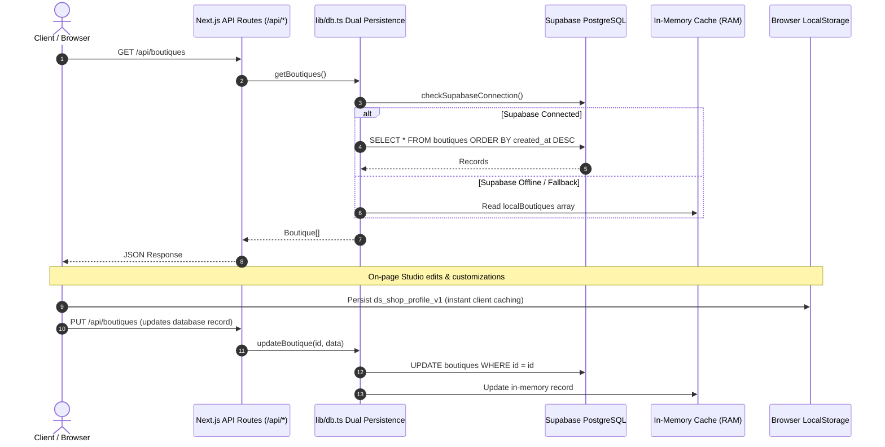

# 06 — DATA FLOW & PERSISTENCE AUDIT

## 1. Data Architecture Overview
DESIGNERSALE handles data persistence and state synchronization across multiple storage layers:

---

## 2. Entity Schemas & Relationships

### 2.1 Boutiques (`boutiques`)
- `id` (string, PK): Unique slug or identifier (e.g., `aesop-fitzroy`, `marton-and-davis`).
- `name` (string): Commercial name.
- `tagline` (string): Editorial summary.
- `city` (string): Melbourne, Sydney, Brisbane, Perth, Adelaide, Byron Bay.
- `neighborhood` (string): Precinct (Fitzroy, Armadale, Paddington, etc.).
- `category` (string): Fashion, Ceramics & Home, Books & Art, Antiques, Concept.
- `address` (string): Full street address.
- `hours` (string): Human-readable hours.
- `price_tier` (string): `$$, $$$, $$$$`.
- `description` (text): Longform editorial review.
- `curator_note` (text): Curator anthology note.
- `image` (string): CDN URL or local static asset path.
- `featured` (boolean): Flag for landing spotlight.
- `tags` (text[] / jsonb): Array of search tags.

### 2.2 City Guides (`guides`)
- `id` (string, PK): `melbourne-edit`, `sydney-edit`.
- `title` (string): Editorial title.
- `city` (string): Target metropolis.
- `kicker` (string): Publication volume & season.
- `subtitle` (string): Editorial subtitle.
- `reading_time` (string): e.g., "8 Min Read".
- `hero_image` (string): Cover photograph.
- `published` (boolean): Visibility state.
- `content` (jsonb): Structured body sections & curator notes.

### 2.3 Journal Articles (`journal_articles`)
- `id` (string, PK): `architectural-flagships`, `tactile-ceramics`, etc.
- `title` (string): Article headline.
- `category` (string): Design, Materiality, Retrospective.
- `date` (string): Formatted publication month.
- `read_time` (string): Estimated reading duration.
- `author` (string): Contributing critic or board.
- `image` (string): Feature image URL.
- `published` (boolean): Editorial publish state.

### 2.4 Cloudinary Media Flow
1. Client selects file (or pastes URL).
2. Direct upload or proxy to `/api/upload`.
3. Server invokes `cloudinary.uploader.upload(buffer, { folder: "designersale" })`.
4. Secure Cloudinary CDN URL returned to client.
5. In-place visual editor immediately displays updated image without full page reload.

---

## 3. Data Integrity & Validation Findings
- **Data Fallback Resilience:** When Supabase is not running locally, `lib/db.ts` intercepts all queries safely and returns in-memory seeded records without throwing unhandled exceptions.
- **State Synchronization Gap:** Previously, changes made inside `ShopProfileClient` only saved to `localStorage.ds_shop_profile_v1` without a button to sync directly to the backend database API.
